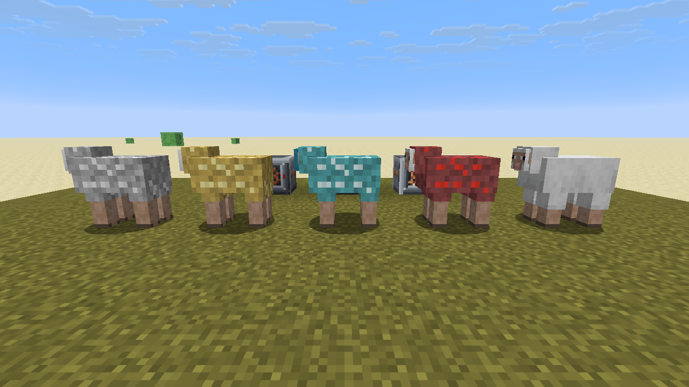
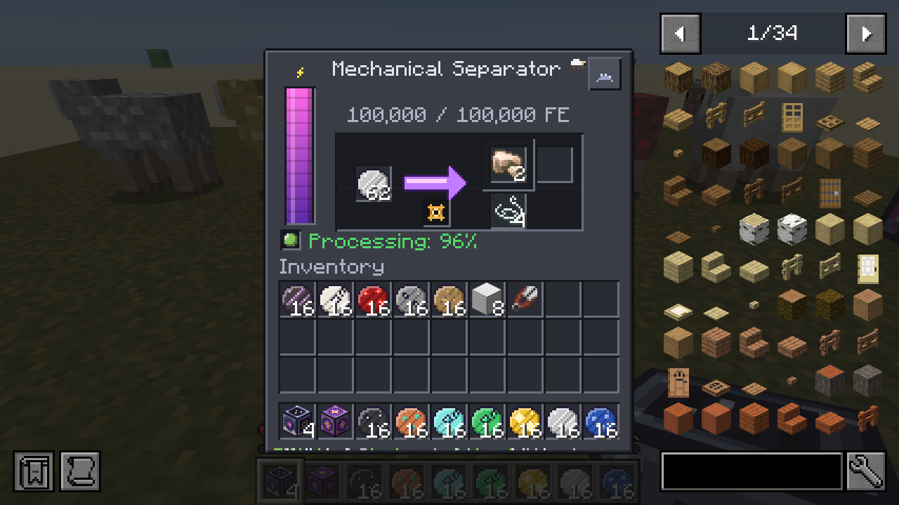
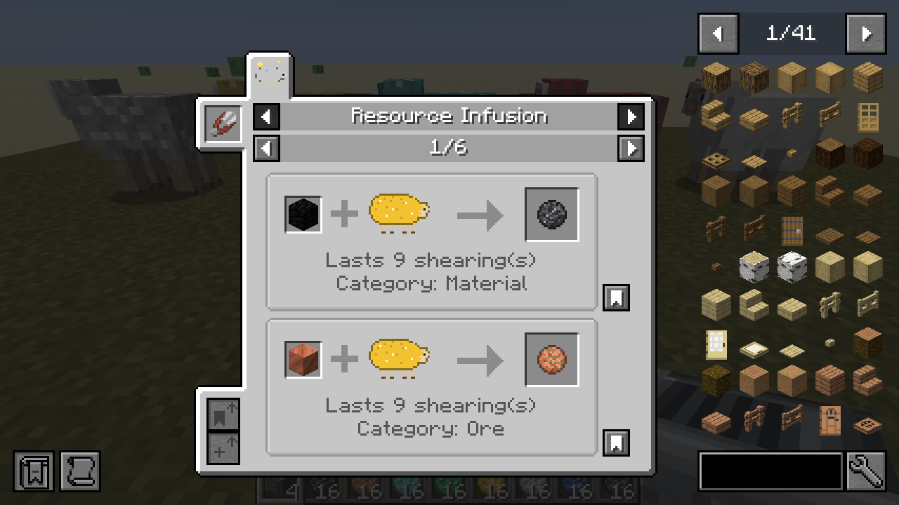
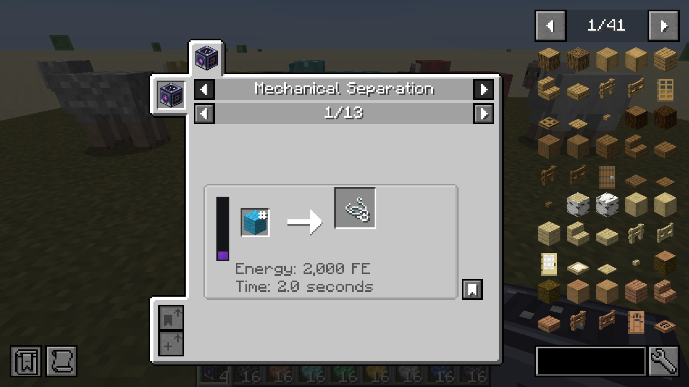

# Resourceful Sheep

A NeoForge mod for **Minecraft Java Edition 26.3**. You feed sheep blocks, ingots and gems to infuse their wool, then shear them for resource wool. A powered **Mechanical Separator** turns that wool back into the resource plus string.

The mod is data-driven: resource definitions are reloadable JSON, gameplay numbers live in the config, and JEI integration is optional.

| | |
|---|---|
| Minecraft | 26.3 |
| NeoForge | 26.3.0.101 or newer |
| Java | 25 |
| JEI (optional) | 31.17.0.109 or newer for 26.3 |



| Mechanical Separator | JEI: Resource Infusion | JEI: Mechanical Separation |
|---|---|---|
|  |  |  |

*These are real screenshots, captured in-game with `./gradlew runClient -PscreenshotHarness`.*

---

## Gameplay

### 1. Infuse a sheep
Right-click an **adult** sheep while holding a resource, for example an **Iron Block**.

- One item is consumed (this is configurable). You'll see coloured particles and hear a chime.
- The sheep's fleece takes on the resource colour with glinting strands, and **small blocks of the resource grow out of its back** (iron blocks on an iron sheep, diamond blocks on a diamond sheep, logs on a wood sheep). The clusters shrink as the infusion is used up by shearing.
- Its dye colour still shows through slightly, so a blue diamond sheep looks different from a white one.
- Each infusion lasts a set number of shearings. Iron, gold, copper, redstone, lapis and coal blocks last **9** shearings (one block holds 9 items). Single items such as diamond, emerald, netherite scrap, cobblestone, oak log and quartz last **1**.
- Feeding an item that isn't a resource does nothing special, so wheat breeding, dyes and so on work as normal.
- Sneak + right-click a sheep with an empty hand to see its infusion and how many shearings it has left.

### 2. Shear it
Shears and dispensers both work. An infused sheep drops **resource wool** (e.g. *Iron Wool*) **instead of** its normal wool. When the infusion runs out the sheep goes back to normal.

### 3. Separate the wool
Put the wool into a **Mechanical Separator** and supply Forge Energy (FE).

| Example | Value |
|---|---|
| Input | 1 Iron Wool |
| Energy | 20,000 FE (200 FE/t) |
| Time | 100 ticks (5 s) |
| Output | 1 Raw Iron + 2 String (+10% chance of 3 Iron Nuggets) |

**Balance:** with the defaults, one Iron Block gives 9 Raw Iron in total and one Diamond gives 1 Diamond. What you gain is **string**, automation, and access to ore-processing chains. Pack makers can turn it into a generator with the config multipliers.

### Crafting the separator
```
I H I      I = Iron Ingot     H = Hopper
P S P      P = Piston         S = Shears
C R C      C = Copper Ingot   R = Redstone
```
- Requires a stone pickaxe or better.
- Hardness 3.5, blast resistance 6.
- When broken, it keeps its stored energy and redstone mode.

### Creative Generator (testing)
A creative-only block, found in the Resourceful Sheep creative tab. It has no recipe and can't be broken in survival.
- Produces **unlimited Forge Energy**.
- Every tick it pushes FE into all adjacent energy receivers. The rate is `creativeGeneratorOutput` (1,000,000 FE/t by default); receivers still apply their own input limits.
- Cables and machines can also **pull** unlimited FE from any side.
- Place it against any energy face of a Mechanical Separator to test without building a power setup.

### Built-in resources

| Fed item | Wool | Separator output | Uses | FE / time |
|---|---|---|---|---|
| Iron Block | Iron Wool | Raw Iron | 9 | 20,000 / 5 s |
| Gold Block | Gold Wool | Raw Gold | 9 | 20,000 / 5 s |
| Copper Block | Copper Wool | Raw Copper | 9 | 16,000 / 5 s |
| Diamond | Diamond Wool | Diamond | 1 | 40,000 / 8 s |
| Emerald | Emerald Wool | Emerald | 1 | 40,000 / 8 s |
| Redstone Block | Redstone Wool | Redstone Dust | 9 | 12,000 / 4 s |
| Lapis Lazuli Block | Lapis Wool | Lapis Lazuli | 9 | 12,000 / 4 s |
| Coal Block | Coal Wool | Coal | 9 | 8,000 / 4 s |
| Netherite Scrap | Netherite Wool | Netherite Scrap | 1 | 80,000 / 10 s |
| Cobblestone | Stone Wool | Cobblestone | 1 | 4,000 / 2 s |
| Oak Log | Wood Wool | Oak Log | 1 | 4,000 / 2 s |
| Quartz | Quartz Wool | Nether Quartz | 1 | 16,000 / 5 s |

Every resource also gives 2 String. Plain wool (`#minecraft:wool`) can be separated into 3 string through the bundled `resourcefulsheep:separating` recipe.

### The Mechanical Separator GUI
- **Energy bar:** shows stored / max FE. Hover for the input rate and the current usage per tick.
- **Progress arrow and spinning gear:** hover for time remaining and the cost of one operation.
- **Status lamp and text:** Idle, Processing %, No Energy, Output Full, Invalid Input or Disabled by Redstone. Hover for an explanation.
- **Redstone button** (top right): cycles Ignored → Active with Signal → Active without Signal → Disabled.
- **Slots:** wool input, resource output, string output and bonus output.

### Automation
- **Items:** by default, hoppers and pipes insert wool through the top, back, left and right faces, and extract outputs from the bottom. Outputs are also auto-pushed into any inventory below the machine. Only items the machine can process are accepted.
- **Energy:** FE is accepted on every face except the front, through NeoForge's `EnergyHandler` capability (`Capabilities.Energy.BLOCK`). Any FE cable or generator works with it.
- **No voiding:** the machine never starts or finishes an operation unless all outputs are guaranteed to fit.
- **No power:** when energy runs out, progress pauses and resumes later.
- **Comparator:** reads how full the input slot is.

---

## Installation
1. Install NeoForge 26.3.0.101+ for Minecraft 26.3.
2. Put `resourcefulsheep-1.0.0.jar` in your `mods/` folder. Installing JEI as well is recommended.
3. The mod is needed on **both** client and server.

## Building from source
```bash
./gradlew build
```
- Requires JDK 25. Gradle uses toolchains, and the wrapper downloads Gradle 9.2.1.
- The mod jar is written to `build/libs/resourcefulsheep-<version>.jar`.

Other useful tasks:

| Command | What it does |
|---|---|
| `./gradlew runClient` | Development client (JEI included at runtime) |
| `./gradlew runServer` | Development dedicated server (`run-server/`) |
| `./gradlew runGameTestServer` | Runs the in-world integration tests on a headless dedicated server |
| `./gradlew test` | JUnit unit tests |
| `./gradlew runClient -PscreenshotHarness` | Creates a flat test world, stages the mod's content, saves screenshots to `run/screenshots/` and quits |
| `python3 tools/generate_textures.py` | Regenerates all PNG art |
| `python3 tools/generate_data.py` | Regenerates models, blockstates, lang, built-in resources, recipes, loot and tags |

**IntelliJ IDEA:** *File → Open* and select `build.gradle`. ModDevGradle sets up the run configurations on sync.

---

## Configuration

### Global config (per world, synced to clients)
`<world>/syncedconfig/resourcefulsheep-synced.toml` (you can also edit it in-game from *Mods → Resourceful Sheep → Config*).

**`[sheep]`**

| Key | Default | Meaning |
|---|---|---|
| `feedingEnabled` | true | Master switch for feeding |
| `feedingAmountOverride` | -1 | Items consumed per feeding (-1 = use each definition's value) |
| `allowBabies` | false | Allow lambs to be infused |
| `allowFeedingShearedSheep` | true | Infuse a sheep that has no wool yet |
| `allowReplacingInfusion` | false | Feed a different resource to replace an infusion |
| `sameResourceRefreshesUses` | true | Re-feeding the same resource tops the uses back up |
| `infusionConsumedByShearing` | true | `false` makes infusions **permanent** |
| `infusionUsesMultiplier` | 1.0 | Scales every resource's `infusion_uses` |
| `woolDropCountOverride` | -1 | Wool dropped per shearing |
| `shearingBonusChance` / `shearingBonusAmount` | 0.0 / 1 | Chance of extra wool per shearing |
| `preserveWoolColour` | true | Blend the dye colour into infused wool |
| `feedingParticles` | true | Particles and sound when feeding |
| `infusionCooldownTicks` | 0 | Rest time after an infusion runs out |
| `creativeConsumesItems` | false | Whether feeding uses up items in creative |
| `creativeIgnoresCooldown` | true | Creative players bypass the cooldown and the replacement lock |
| `sneakToInspect` | true | Sneak-right-click inspection |

**`[separator]`**

| Key | Default | Meaning |
|---|---|---|
| `energyCapacity` | 100000 | FE buffer |
| `maxEnergyInput` | 1000 | FE accepted per tick |
| `defaultEnergyCost` | 20000 | FE per operation when a resource doesn't set one |
| `energyPerTickOverride` | 0 | Fixed FE/t for every recipe (0 = derive from cost ÷ time) |
| `defaultProcessingTicks` | 100 | Time when a resource doesn't set one |
| `defaultStringOutput` | 2 | String when a resource doesn't set `secondary_count` |
| `primaryOutputMultiplier` | 1.0 | Scales the resource output; fractional parts become a chance |
| `bonusPrimaryChance` | 0.0 | Global chance of +1 resource output |
| `energyCostMultiplier` | 1.0 | Efficiency multiplier for energy |
| `processingSpeedMultiplier` | 1.0 | Speed multiplier (total energy is unchanged) |
| `resetProgressWhenUnpowered` | false | Reset progress instead of pausing it |
| `energyInputSides` | BACK, LEFT, RIGHT, TOP, BOTTOM | Faces that accept FE |
| `itemInputSides` | TOP, BACK, LEFT, RIGHT | Faces that accept wool |
| `itemOutputSides` | BOTTOM | Faces to extract from and auto-push into |
| `autoPushOutputs` / `autoPushInterval` | true / 10 | Automatic output |
| `redstoneControlEnabled` / `defaultRedstoneMode` | true / IGNORED | Redstone behaviour |

**`[creative_generator]`**

| Key | Default | Meaning |
|---|---|---|
| `creativeGeneratorOutput` | 1000000 | FE pushed into each adjacent receiver per tick (0 = only allow pulling) |

### Client config
`config/resourcefulsheep-client.toml`:

| Key | What it controls |
|---|---|
| `ambientParticles` | Particles around infused sheep |
| `dyeTintStrength` | How strongly the dye colour shows through infused wool |
| `showResourceGrowths` | Resource blocks growing out of infused fleece |
| `showSheepSparkleOverlay` | The glinting overlay on infused fleece |
| `detailedWoolTooltips` | Always show separator details in wool tooltips |
| `detailedMachineTooltips` | Extra detail in the separator GUI tooltips |

---

## Resource definitions (data packs)

Definitions live in `data/<namespace>/resourcefulsheep/sheep_resources/<name>.json`.
- The resource id is `<namespace>:<name>`.
- They reload with `/reload` and are synced to clients automatically, so JEI and tooltips update too.
- Feeding, shearing, the separator and JEI all read the same definition.

```jsonc
{
  // Optional NeoForge load conditions: skip the file when a mod isn't installed.
  "neoforge:conditions": [ { "type": "neoforge:mod_loaded", "modid": "mekanism" } ],

  "feeding_item": "#c:storage_blocks/tin",   // item id, #tag, or a list
  "feeding_amount": 1,                       // default 1
  "display_name": "Tin",                     // optional text component; default: translation key resource.<ns>.<name>
  "wool_name": "Tin Wool",                   // optional; default "<display_name> Wool"
  "wool_color": "#B8C4CC",                   // "#RRGGBB", integer, or [r, g, b] (0-255)
  "accent_color": "#E6EEF2",                 // colour of the glinting strands
  "category": "ore",                         // ore | gem | dust | material | organic
  "wool_drop_count": 1,                      // wool per shearing
  "infusion_uses": 9,                        // shearings per feeding
  "separator": {
    "primary_output": "mekanism:raw_tin",    // item id or {"id": ..., "count": ..., "components": {...}}; default: the fed item
    "primary_count": 1,
    "secondary_output": "minecraft:string",  // default string
    "secondary_count": 2,                    // default: config defaultStringOutput (0 = none)
    "bonus_output": { "item": "mekanism:nugget_tin", "chance": 0.1 },
    "energy_cost": 20000,                    // total FE; default: config
    "processing_ticks": 100                  // default: config
  },
  "growth_item": "mekanism:block_tin"        // optional: block shown growing out of the fleece; default: the fed item
}
```

**Ores vs other materials.** For an ore, set `primary_output` to the raw material (as the built-ins do with Raw Iron). If you leave `primary_output` out, the separator gives back the fed item, which suits gems, logs and stone. A block input never implies 9 outputs automatically; you choose the numbers.

**Missing items.** A definition that references an item from a mod that isn't installed is skipped. The log gets one warning saying which file and which item; the rest of the reload is unaffected. Empty tags are skipped the same way.

**Examples.** Ready-made definitions for **Tin, Lead, Silver, Nickel, Uranium, Osmium, Aluminium** and **Amethyst** are in `examples/resource_definitions/`. `examples/datapack/` is the same set packaged as a drop-in data pack, plus an example cobweb separating recipe. Copy the folder into `<world>/datapacks/`.

### Auto-generating resources for every material
You don't have to write a definition for every metal by hand. In a world with cheats on (operator level 2), run:

| Command | What it does |
|---|---|
| `/resourcefulsheep preview` | Lists what would be generated, without changing anything |
| `/resourcefulsheep generate` | Creates a resource for every material that doesn't have one yet, saves them into the world data pack `resourcefulsheep_generated`, and reloads |
| `/resourcefulsheep generate all` | Same, but also regenerates materials that already have a definition |
| `/resourcefulsheep list` | Lists every loaded resource |

How the generator chooses each value:
- **Materials:** it scans the `c:storage_blocks/<material>` item tags that vanilla, NeoForge and nearly every content mod fill. With Mekanism, Thermal and similar mods installed, that covers tin, lead, osmium, uranium, silver and so on. Raw ore blocks (`raw_*`) and anything already defined are skipped.
- **Feeding item:** the storage-block tag, so every mod's variant of the block works.
- **Output:** the first item in `c:raw_materials/`, `c:ingots/`, `c:gems/` or `c:dusts/<material>`. If none exist, it uses an item named after the material (for example `slime_ball` or `resin_clump`), and failing that, the block itself.
- **Uses:** 9 when a block is broken down into one of those units (a block holds 9), otherwise 1.
- **Colours:** taken from the block's map colour. The category comes from whichever tag supplied the output.

Generated files are ordinary JSON in `<world>/datapacks/resourcefulsheep_generated/`. You can edit them freely, but re-running `generate` overwrites that folder. In plain vanilla this adds Bone Meal, Dried Kelp, Resin, Slime and Wheat.

### Explicit separator recipes
Use the recipe type `resourcefulsheep:separating` to process any item, or to override how a particular wool is handled:
```json
{
  "type": "resourcefulsheep:separating",
  "ingredient": "#minecraft:wool",
  "primary_output": { "id": "minecraft:string", "count": 3 },
  "secondary_output": "minecraft:white_dye",
  "bonus_output": { "item": "minecraft:string", "chance": 0.1 },
  "energy_cost": 2000,
  "processing_ticks": 40
}
```
An explicit recipe always takes priority over a resource definition. JEI shows only the recipe that actually applies.

### Tags
| Tag | Default contents | Purpose |
|---|---|---|
| `#resourcefulsheep:infusable` (entity type) | `minecraft:sheep` | Which mobs can be infused. Add modded sheep here. |
| `#resourcefulsheep:replaceable_wool` (item) | `#minecraft:wool` | Which drops infused wool replaces |

Shearing drops are hooked through a global loot modifier on loot tables whose path starts with `shearing/`. That means hand shears, dispensers and modded shears are all covered, along with modded sheep that use their own `shearing/...` table. Infused-fleece rendering is applied to any entity whose renderer extends the vanilla `SheepRenderer`.

### Custom wool textures
The 12 built-in wools have hand-made textures. Any other resource uses a greyscale wool texture tinted with its `wool_color` and `accent_color`, so it never shows a missing texture.

To give a data-pack resource its own icon, ship a resource pack that overrides `assets/resourcefulsheep/items/resource_wool.json` and adds a `case` for your resource id. The file is a `minecraft:select` on the `resourcefulsheep:sheep_resource` component.

---

## Technical overview
| Concern | Implementation |
|---|---|
| Sheep state | NeoForge data attachment `resourcefulsheep:sheep_infusion` (saved with the entity, auto-synced to tracking clients) |
| Wool identity | One item `resourcefulsheep:resource_wool` + data component `resourcefulsheep:sheep_resource` (no runtime item registration) |
| Shearing | Global loot modifier `resourcefulsheep:infused_wool`; the infusion is consumed exactly once per loot roll |
| Definitions | Server reload listener; synced to clients in `OnDatapackSyncEvent` (before recipes, so JEI sees them) |
| Machine | `MechanicalSeparatorBlockEntity` with the transfer-API `ResourceHandler<ItemResource>` (sided views) and `EnergyHandler` |
| Sheep rendering | Render-state modifier + `InfusedWoolLayer` re-using the vanilla fur model (all animations intact) |
| Item colours | `minecraft:select` on the component for built-ins; custom `resourcefulsheep:resource_wool` tint source as the fallback |
| JEI | `@JeiPlugin`. JEI is an optional dependency, and the plugin is only class-loaded when JEI is present. |
| Client/server split | Client code lives in `client/` and is registered from a `@Mod(dist = CLIENT)` entry point |

### API changes vs older versions (documented deviations)
- **Config type.** In current FML the per-world, synced config type is `ModConfig.Type.SYNCED` (it used to be `SERVER`), so the file lives in `<world>/syncedconfig/`.
- **Energy capability.** Energy uses NeoForge's transfer API (`EnergyHandler`, `Capabilities.Energy.BLOCK`) instead of the removed `IEnergyStorage`. It is still Forge Energy, so FE cables interoperate.
- **Item capability.** Items use `ResourceHandler<ItemResource>` (`Capabilities.Item.BLOCK`) instead of `IItemHandler`.
- **No `wool_texture` field.** The illustrative schema's `wool_texture` field is replaced by the item-model `select` mechanism described above. Item models in 26.x are resource-pack data, not something a data pack can set.

## Testing
See [TESTING.md](TESTING.md) for what has been verified and the known limitations.

## License
MIT. See `LICENSE`. All textures were generated for this project by `tools/generate_textures.py`.
